<div align="center">

  <!-- COMMAND CENTER HEADER -->
  <br/>
  <a href="https://rehanhussain.dev" target="_blank">
    
  </a>

  <br/>

  <!-- DYNAMIC TYPING ROLE SWITCHER (Portfolio Aligned) -->
  <picture>
    <source media="(prefers-color-scheme: dark)" srcset="https://readme-typing-svg.demolab.com?font=Space+Grotesk&weight=700&size=22&pause=1000&color=E2652C;F2814F;F5F3F0&center=true&vCenter=true&width=800&lines=Full+Stack+Developer+%26+Software+Engineer;Node.js+%7C+TypeScript+%7C+React+%7C+Next.js;n8n+Automation+%26+Autonomous+AI+Agents;Custom+Web+Apps,+Dashboards+%26+E-Commerce.">
    <source media="(prefers-color-scheme: light)" srcset="https://readme-typing-svg.demolab.com?font=Space+Grotesk&weight=700&size=22&pause=1000&color=E2652C;EA580C;14110F&center=true&vCenter=true&width=800&lines=Full+Stack+Developer+%26+Software+Engineer;Node.js+%7C+TypeScript+%7C+React+%7C+Next.js;n8n+Automation+%26+Autonomous+AI+Agents;Custom+Web+Apps,+Dashboards+%26+E-Commerce.">
    
  </picture>

</div>

<div align="center">
  <a href="https://rehanhussain.dev" target="_blank">
    
  </a>
  <a href="https://www.linkedin.com/in/rehancodeofficial/" target="_blank">
    
  </a>
  <a href="https://github.com/rehancodeofficial" target="_blank">
    
  </a>
  <a href="https://wa.me/923148100272" target="_blank">
    
  </a>
  <a href="mailto:rehancodeofficial@gmail.com" target="_blank">
    
  </a>
</div>

<div align="center">
  <picture>
    <source media="(prefers-color-scheme: dark)" srcset="https://readme-typing-svg.demolab.com?font=Space+Grotesk&weight=700&size=20&pause=2000&color=23232A&center=true&vCenter=true&width=800&lines=━━━━━━━━━━━━━━━━━━━━━━━━━━━━━━━━━━━━━━━━━━━━━━━━━━━━━━━━━━━━━━━━━━━━━━━━━━━━">
    <source media="(prefers-color-scheme: light)" srcset="https://readme-typing-svg.demolab.com?font=Space+Grotesk&weight=700&size=20&pause=2000&color=E6E2DC&center=true&vCenter=true&width=800&lines=━━━━━━━━━━━━━━━━━━━━━━━━━━━━━━━━━━━━━━━━━━━━━━━━━━━━━━━━━━━━━━━━━━━━━━━━━━━━">
    
  </picture>
</div>

<!-- Bio Section -->
<div align="center">
  <h2> ABOUT & ENGINEERING VISION</h2>
</div>

<table align="center" style="border: none; background: transparent;">
  <tr style="border: none;">
    <td width="60%" style="border: none; vertical-align: top;">
      <h3> The Mind Behind The Code</h3>
      <p>I'm <b>Muhammad Rehan Hussain</b>, a <b>Full Stack Developer & Co-Founder at Code Vertex Solutions</b>. I build WordPress & Shopify sites, custom web apps, real-time dashboards, autonomous n8n workflows, and AI agents — with a high-performance backend foundation in <b>Node.js, TypeScript, PostgreSQL, and modern web architectures</b>.</p>
      <ul>
        <li> <b>Core Philosophy:</b> Build with precision. Architect for scalability. Deliver with excellence.</li>
        <li> <b>Backend & Databases:</b> Node.js, Express.js, TypeScript, PostgreSQL, MongoDB, Prisma, Supabase, Redis, REST APIs, WebSockets.</li>
        <li> <b>Frontend & Web Apps:</b> React, Next.js, TypeScript, JavaScript, Tailwind CSS, HTML5, CSS3, Vite.</li>
        <li> <b>Automation, AI & CMS:</b> n8n Automation Workflows, OpenAI API, Custom AI Agents, Shopify (Liquid / OS 2.0), WordPress, WooCommerce.</li>
        <li> <b>Education:</b> BS Software Engineering — Iqra University (Karachi).</li>
      </ul>
    </td>
    <td width="40%" align="center" style="border: none; vertical-align: middle;">
      
    </td>
  </tr>
</table>

---

###  PROFESSIONAL EXPERIENCE

```text
┌── [Jul 2026 – Present] Co-Founder & Full Stack Developer @ Code Vertex Solutions
│   └── Building backend services & REST APIs with Node.js and Express.js, data modeling with PostgreSQL & MongoDB, 
│       third-party API integrations, deployment, and end-to-end software delivery with a 4-member dev team.
│
├── [Jan 2026 – Present] Full Stack Developer @ NorthernX Technologies
│   └── Full-stack development across client products — React & TypeScript frontends connected to Node.js 
│       microservices, PostgreSQL data modeling, REST API design, and production deployment.
│
├── [Oct 2024 – Jan 2026] Full Stack Developer @ MT Nexus Global
│   └── REST APIs and database development using Node.js, TypeScript, and modern frontends. Debugging production applications, 
│       feature scoping, and architecture for healthcare & logistics platforms (CureVirtual 2.0, TranspoPilot AI).
│
└── [Jan 2024 – Jun 2024] Web Developer Intern @ Monami Technologies
    └── Built REST API integrations, designed schemas, and implemented RBAC across internal tools using Node.js, React, 
        PostgreSQL, and MongoDB.
```

---

###  CORE ENGINEERING ARSENAL

<div align="center">
  <p><b>Frontend & User Interfaces</b></p>
  <picture>
    <source media="(prefers-color-scheme: dark)" srcset="https://skillicons.dev/icons?i=html,css,js,ts,react,nextjs,tailwind,redux,vite&theme=dark">
    <source media="(prefers-color-scheme: light)" srcset="https://skillicons.dev/icons?i=html,css,js,ts,react,nextjs,tailwind,redux,vite&theme=light">
    
  </picture>
  <br><br>
  
  <p><b>Backend, Databases & Realtime Systems</b></p>
  <picture>
    <source media="(prefers-color-scheme: dark)" srcset="https://skillicons.dev/icons?i=nodejs,express,postgres,mongodb,redis,prisma,supabase,firebase&theme=dark">
    <source media="(prefers-color-scheme: light)" srcset="https://skillicons.dev/icons?i=nodejs,express,postgres,mongodb,redis,prisma,supabase,firebase&theme=light">
    
  </picture>
  <br><br>
  
  <p><b>CMS, E-Commerce & Workflow Automation</b></p>
  <div>
    
    
    
    
    
    
  </div>
  <br>

  <p><b>DevOps, Cloud & Tooling</b></p>
  <picture>
    <source media="(prefers-color-scheme: dark)" srcset="https://skillicons.dev/icons?i=docker,git,github,postman,vercel,npm&theme=dark">
    <source media="(prefers-color-scheme: light)" srcset="https://skillicons.dev/icons?i=docker,git,github,postman,vercel,npm&theme=light">
    
  </picture>
</div>

<br/>

---

###  FEATURED PRODUCTION ECOSYSTEMS & CLIENT PROJECTS

<table>
  <tr>
    <td width="50%" valign="top">
      <h4><a href="https://clientpilotai.rehanhussain.dev/">🎯 ClientPilot AI</a></h4>
      <p><b>AI-Assisted Lead Acquisition Platform:</b> Discovers business leads via Overpass API, scores them with OpenAI, and delivers automated outreach with real-time WebSocket telemetry.</p>
      <p><code>Node.js</code> <code>TypeScript</code> <code>PostgreSQL</code> <code>OpenAI API</code> <code>WebSockets</code></p>
    </td>
    <td width="50%" valign="top">
      <h4><a href="https://bitedash.rehanhussain.dev/">🍔 BiteDash</a></h4>
      <p><b>Multi-Tenant Food Delivery Platform:</b> End-to-end delivery ecosystem with customer, restaurant, rider, and admin portals featuring live Socket.io order tracking and Stripe payments.</p>
      <p><code>React</code> <code>Node.js</code> <code>PostgreSQL</code> <code>Prisma</code> <code>Redis</code> <code>Socket.io</code></p>
    </td>
  </tr>
  <tr>
    <td width="50%" valign="top">
      <h4><a href="https://pulsehr.rehanhussain.dev/">💼 PulseHR</a></h4>
      <p><b>Enterprise HR Management System:</b> Production-ready HR suite featuring automated employee onboarding, payroll, attendance, real-time WebSocket updates, and Supabase file storage.</p>
      <p><code>React 19</code> <code>TypeScript</code> <code>Node.js</code> <code>PostgreSQL</code> <code>Supabase Storage</code></p>
    </td>
    <td width="50%" valign="top">
      <h4>🚚 TranspoPilot AI</h4>
      <p><b>Fleet Visibility & Logistics Platform:</b> Trucking platform featuring AI-driven route optimization, smart fuel finding, real-time GPS fleet tracking, ELD logging, and HOS compliance.</p>
      <p><code>React</code> <code>TypeScript</code> <code>Node.js</code> <code>PostgreSQL</code> <code>OpenAI API</code> <code>WebSocket</code></p>
    </td>
  </tr>
  <tr>
    <td width="50%" valign="top">
      <h4>🤖 PhoneBuzz AI Agent & CRM</h4>
      <p><b>n8n Automation + WhatsApp CRM:</b> 100+ node autonomous pipeline handling customer queries across WhatsApp and email, paired with an inventory and real-time revenue analytics CRM.</p>
      <p><code>n8n</code> <code>OpenAI API</code> <code>WhatsApp API</code> <code>React</code> <code>Node.js</code> <code>PostgreSQL</code></p>
    </td>
    <td width="50%" valign="top">
      <h4>🛍️ BookHaven & Shopify Solutions</h4>
      <p><b>Shopify OS 2.0 & E-Commerce Storefront:</b> Bespoke Shopify storefront with Liquid templates, structured metafields, custom filters, and AJAX cart drawer.</p>
      <p><code>Shopify Liquid</code> <code>OS 2.0</code> <code>Cart API</code> <code>Metafields</code> <code>JavaScript</code></p>
    </td>
  </tr>
</table>

<div align="center">
  <br/>
  <a href="https://clientpilotai.rehanhussain.dev/" target="_blank">
    
  </a>
  <a href="https://bitedash.rehanhussain.dev/" target="_blank">
    
  </a>
</div>

<br/>

---

###  SYSTEM TELEMETRY (GitHub Pulse)

<div align="center">
  <!-- GitHub Stats (Adapts automatically between Dark and Light mode) -->
  <picture>
    <source media="(prefers-color-scheme: dark)" srcset="https://github-readme-stats.shion.dev/api?username=rehancodeofficial&show_icons=true&bg_color=0B0B0D&title_color=E2652C&text_color=CFCBC6&icon_color=F2814F&border_color=23232A&border_radius=8">
    <source media="(prefers-color-scheme: light)" srcset="https://github-readme-stats.shion.dev/api?username=rehancodeofficial&show_icons=true&bg_color=FFFFFF&title_color=E2652C&text_color=44403C&icon_color=EA580C&border_color=E6E2DC&border_radius=8">
    
  </picture>

  <!-- Top Languages (Adapts automatically between Dark and Light mode) -->
  <picture>
    <source media="(prefers-color-scheme: dark)" srcset="https://github-readme-stats.shion.dev/api/top-langs/?username=rehancodeofficial&layout=compact&bg_color=0B0B0D&title_color=E2652C&text_color=CFCBC6&border_color=23232A&border_radius=8">
    <source media="(prefers-color-scheme: light)" srcset="https://github-readme-stats.shion.dev/api/top-langs/?username=rehancodeofficial&layout=compact&bg_color=FFFFFF&title_color=E2652C&text_color=44403C&border_color=E6E2DC&border_radius=8">
    
  </picture>
</div>

<br/>

---

###  CONTRIBUTION SNAKE (Ember Orange Palette)

<div align="center">
  <picture>
    <source media="(prefers-color-scheme: dark)" srcset="https://raw.githubusercontent.com/rehancodeofficial/rehancodeofficial/main/github-contribution-grid-snake-dark.svg">
    <source media="(prefers-color-scheme: light)" srcset="https://raw.githubusercontent.com/rehancodeofficial/rehancodeofficial/main/github-contribution-grid-snake.svg">
    
  </picture>
</div>

---

###  GITHUB MEDALS

<div align="center">
  <br/>
  <table style="border: none;">
    <tr style="border: none;">
      <td align="center" style="border: none;">
        
        <br/>
        <b>PULL SHARK</b>
      </td>
      <td align="center" style="border: none;">
        
        <br/>
        <b>QUICKDRAW</b>
      </td>
      <td align="center" style="border: none;">
        
        <br/>
        <b>YOLO</b>
      </td>
    </tr>
  </table>
</div>

---

###  PORTFOLIO & OPERATIONAL METRICS

<div align="center">
  <table style="border-collapse: collapse; width: 65%;">
    <tr>
      <td style="padding: 12px;"> <b>Total GitHub Commits:</b></td>
      <td style="padding: 12px;" align="right"><code>585+</code> COMMITS</td>
    </tr>
    <tr>
      <td style="padding: 12px;"> <b>Professional Experience:</b></td>
      <td style="padding: 12px;" align="right"><code>3+</code> YEARS</td>
    </tr>
    <tr>
      <td style="padding: 12px;"> <b>Clients Delivered:</b></td>
      <td style="padding: 12px;" align="right"><code>9 Total</code> (4 Intl / 5 Local)</td>
    </tr>
    <tr>
      <td style="padding: 12px;"> <b>Systems & Builds:</b></td>
      <td style="padding: 12px;" align="right"><code>20+</code> ECOSYSTEMS</td>
    </tr>
    <tr>
      <td style="padding: 12px;"> <b>Caffeine Fuel:</b></td>
      <td style="padding: 12px;" align="right"><code>1,337+</code> CUPS</td>
    </tr>
    <tr>
      <td style="padding: 12px;"> <b>Bugs Squashed:</b></td>
      <td style="padding: 12px;" align="right"><code>COUNTLESS</code></td>
    </tr>
    <tr>
      <td style="padding: 12px;"> <b>Engineering Focus:</b></td>
      <td style="padding: 12px;" align="right"><code>FULL-STACK + AUTOMATION</code></td>
    </tr>
    <tr>
      <td style="padding: 12px;"> <b>Daily Flow State:</b></td>
      <td style="padding: 12px;" align="right"><code>~ 12 HOURS</code></td>
    </tr>
  </table>
</div>

---

###  WHAT I BUILD & DELIVER

<div align="center">
  <table style="border: none;">
    <tr style="border: none;">
      <td style="border: none;"> <b>n8n Autonomous Workflows & AI Agents (LLM integrations, messaging triage)</b></td>
    </tr>
    <tr style="border: none;">
      <td style="border: none;"> <b>Scalable Web Applications (Node.js & TypeScript full-stack core)</b></td>
    </tr>
    <tr style="border: none;">
      <td style="border: none;"> <b>Executive Dashboards & Portals (Real-time telemetry, WebSockets, clean metrics)</b></td>
    </tr>
    <tr style="border: none;">
      <td style="border: none;"> <b>Custom Shopify OS 2.0 Themes & WordPress/WooCommerce Solutions</b></td>
    </tr>
    <tr style="border: none;">
      <td style="border: none;"> <b>Deep Codebase Diagnostics, Bug Fixing & Performance Tuning</b></td>
    </tr>
  </table>
</div>

---

<div align="center">
  <picture>
    <source media="(prefers-color-scheme: dark)" srcset="https://readme-typing-svg.demolab.com?font=Space+Grotesk&weight=700&size=20&pause=2000&color=E2652C;F2814F&center=true&vCenter=true&width=800&lines=%22Code+is+the+raw+iron+we+forge.%22;%22Architecting+reality,+one+line+at+a+time.%22;%22Execution+is+everything.%22">
    <source media="(prefers-color-scheme: light)" srcset="https://readme-typing-svg.demolab.com?font=Space+Grotesk&weight=700&size=20&pause=2000&color=E2652C;EA580C&center=true&vCenter=true&width=800&lines=%22Code+is+the+raw+iron+we+forge.%22;%22Architecting+reality,+one+line+at+a+time.%22;%22Execution+is+everything.%22">
    
  </picture>
</div>

<br/>

<div align="center">
  
</div>

<div align="center">
  <br />
  <i>Executing Vision with Precision.</i>
  <br />
  <b>Looking to collaborate or build scalable software? Let's connect!</b>
  <br />
  <br />
  
</div>
